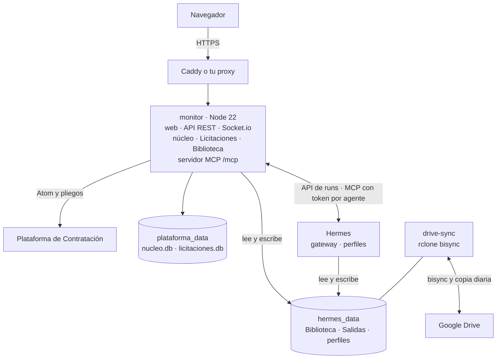
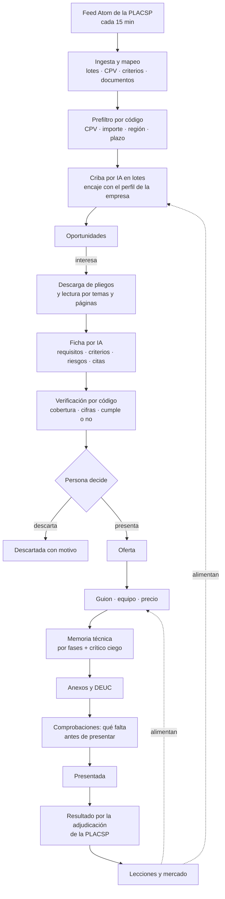
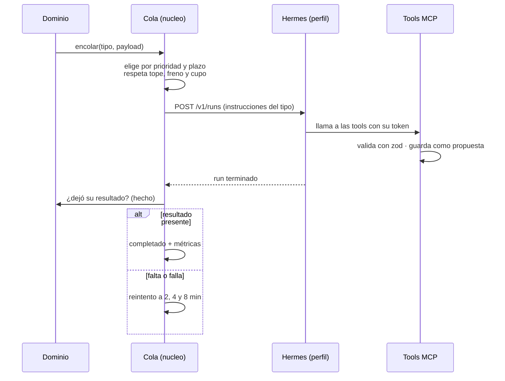

# Arquitectura

Cómo está hecho Sobre Abierto y por qué. Qué hace cada pantalla está en
[Guía de uso](../guia/README.md); cómo se opera una instalación, en [Operar](../operar/README.md); el
entorno de desarrollo, en [Desarrollo](../contribuir/desarrollo.md).

## Idea central

Tres reglas explican casi todo el diseño:

1. **El código escribe los hechos; la IA solo propone.** El código descarga la PLACSP, la normaliza, calcula
   plazos, importes, antecedentes y la lista de lo que falta para presentar. Lo que sale de un modelo (un
   veredicto de encaje, una ficha, un apartado de la memoria) se valida con esquemas estrictos y queda como
   propuesta revisable. Nada entra en la Biblioteca ni cambia una decisión sin que una persona lo apruebe.
2. **Toda la IA corre en Hermes.** El monitor, que es el servidor de la plataforma, no tiene claves de ningún
   modelo. Pide los trabajos a [Hermes Agent](https://github.com/NousResearch/hermes-agent) y Hermes llama de
   vuelta a la plataforma por MCP. Cambiar de proveedor o de modelo es cambiar la configuración de un perfil de
   Hermes.
3. **Drive (o el disco) es la fuente de verdad del conocimiento.** Las bases de datos guardan hechos y estado;
   los documentos viven en carpetas que el equipo ya conoce y edita.

## Componentes

| Servicio | Papel |
|---|---|
| `monitor` | La aplicación: web, API, núcleo, dominios y Biblioteca, en un solo proceso. Es lo único que se publica. |
| `hermes` | El agente de IA. Su dashboard y su API solo son accesibles desde la red interna; el monitor muestra el dashboard bajo `/hermes-panel/` con su propia sesión. |
| `hermes-init` | Se ejecuta antes de arrancar: instala las skills, crea un token por agente y devuelve los permisos del volumen a `uid 10000`. |
| `drive-sync` | Opcional. Sincroniza las carpetas de la Biblioteca con Drive en ambos sentidos y sube una copia diaria. |

Los volúmenes son `hermes_data` (todo Hermes, incluida la Biblioteca en `/opt/data/conocimiento`), `plataforma_data`
(las dos bases SQLite), `vault_data` (el índice de la Biblioteca) y `drive_sync_state` (la conexión con Drive). Sin
Drive, la Biblioteca y las carpetas de cada licitación son directorios de `hermes_data` y todo funciona igual.

## El servidor

Node 22, TypeScript estricto (ESM), Express y Socket.io. Se organiza en tres capas dentro de `apps/server/src`:

| Carpeta | Contenido |
|---|---|
| `nucleo/` | Lo que comparten todos los dominios: configuración validada con zod, usuarios y permisos, autenticación, cola de IA, servidor MCP, perfil de la empresa, marca, avisos por correo, calendario, API de lectura, colaboradores y el cliente de Hermes (`nucleo/hermes/`). |
| `dominios/licitaciones/` | El dominio: ingesta de la PLACSP, criba, ficha, pliegos, propuestas, oferta (guion, memoria técnica, anexos, comprobaciones), mercado y aprendizaje. |
| `biblioteca/` | El motor de la Biblioteca de Conocimiento: indexado, búsqueda y propuestas de notas. |

Reglas de convivencia:

- **Un dominio no importa a otro.** Comparten organizaciones, documentos, eventos y la cola a través del núcleo, y
  se enganchan con funciones de registro (`registrarTipoTrabajo`, `anadirHerramientas`, `registrarEstado`,
  `registrarAvisoPeriodico`…). Añadir un dominio no toca los existentes.
- **Los errores se devuelven como valor** (`Result` en `nucleo/result.ts`) al cruzar fronteras de módulo.
- **Toda entrada externa se valida** con zod antes de tocar la lógica: peticiones, variables de entorno,
  respuestas de la PLACSP y lo que envía Hermes.
- **Persistencia en SQLite** (modo WAL): `nucleo.db` para lo compartido y una base por dominio. Un hilo escribe y el
  servidor lee. Para el volumen real (cientos de miles de adjudicaciones) no hace falta una base documental ni
  vectorial.

## Del radar a la oferta

El flujo completo de Licitaciones. Cada flecha que sale de «IA» es un trabajo de la cola y cada resultado vuelve
por MCP.

- **Prefiltro amplio, criba precisa.** El código no pierde nada (busca recall); la IA decide con el perfil de la
  empresa (busca precisión), en uno o dos runs al día.
- **En la ficha, manda el código cuando tiene el dato.** Hermes leía mal cifras del perfil, así que el código corrige
  el «cumple» y deja a la vista lo que había dicho el modelo. Donde no hay dato, decide Hermes y cita la página.
- **Los pliegos se leen por temas y páginas, no de principio a fin.** Un pliego real puede tener 270.000 caracteres;
  leerlo entero agota el contexto del modelo. Los pasajes por tema y la lectura por páginas dan lo que importa con
  su cita.
- **Las comprobaciones son código puro.** Reglas deterministas sobre la oferta (documentos, plazos, decisiones, compromisos,
  coherencia) dicen qué impide presentar, qué es riesgo y qué se puede ignorar. No usan IA.
- **El resultado sale de la PLACSP.** Es un hecho publicado: el código lo compara con el NIF del perfil. Lo que una
  persona pone a mano manda, y una UTE no se decide sola.

La memoria técnica tiene su propio documento: [Memoria técnica](memoria-tecnica.md). En resumen, toda memoria
nueva recorre las mismas fases (dossier, estrategia, ficha de solución, redacción entera, crítica ciega, corrección
de hechos y fin) y su estado vive en `memorias.fase` (vacía en una versión subida a mano o montada por el método
anterior). «Nueva versión», «Actualizar los apartados afectados» y la fase `ronda_memoria` de `licitaciones_pedir`
comparten una sola función (`actualizarMemoria`): crean la versión siguiente, de cambio tardío (conserva el texto)
o de mejora (reescribe para el tramo máximo con la evaluación de la base), copian lo que no se rehace y no vuelven a
pedir dossier ni estrategia salvo que la base no los tenga. Una versión subida a mano no sirve de base.

## La cola de IA

Cada trabajo es un run en la API de Hermes (`POST /v1/runs` con `Idempotency-Key`). La cola vive en `nucleo.db`
(`trabajos_ia`) y es genérica: cada dominio registra sus tipos de trabajo.

Lo que conviene saber:

- **Cada tipo declara tres cosas**: a qué perfil va, qué instrucciones lleva y cómo comprobar que el agente dejó su
  resultado. Si el run termina sin dejarlo, el trabajo falla y reintenta.
- **Prioridad**: primero las ofertas en preparación por plazo más cercano, luego las fichas de lo nuevo y al final
  la criba, las lecciones y las actas de mercado. Como mucho `HERMES_RUNS_A_LA_VEZ` trabajos a la vez.
- **Frenos que protegen el gasto**: si los tres últimos trabajos de un tipo fallaron, ese tipo se detiene seis horas;
  un límite de uso del proveedor (HTTP 429) pausa toda la cola 30 minutos sin gastar intentos; un run sin llamadas
  a herramientas durante diez minutos se da por muerto. Una versión nueva del servidor levanta los frenos, porque un
  arreglo no debe esperar seis horas.
- **Métricas por trabajo**: modelo, proveedor, tokens, llamadas y duración, sacadas de la respuesta del run, de la
  sesión del perfil y de la auditoría MCP. Sirven para comparar modelos con las mismas fichas y para calcular el
  coste de una licitación.
- **Sin perfil configurado, el trabajo espera** sin gastar intentos ni bloquear a los demás tipos.

El código está en `apps/server/src/nucleo/`: `trabajos.ts` es el núcleo (encolar, lanzar, seguir el run, fallar y
reintentar) y alrededor van `colaTipos.ts` (tipos y registro), `colaOrden.ts` (prioridad y cupos), `colaEsperas.ts`
(esperas sin gastar intento), `colaFrenos.ts`, `colaRelanzado.ts` (colgados y zombis), `colaEstadisticas.ts`,
`colaConsultas.ts`, `colaAlertas.ts`, `colaEta.ts`, `colaResumen.ts` y `colaMarcas.ts`.

## MCP y permisos

Hermes, sus perfiles y cualquier cliente MCP (Claude Code, por ejemplo) usan las mismas herramientas por el
endpoint `/mcp`. Cada agente tiene su token y su conjunto de permisos (`leer` o `proponer` por dominio); una tool
solo se registra si el agente puede usarla, y cada llamada queda en la auditoría. La lista completa, generada del
código, está en [Servidor MCP](../referencia/mcp.md).

Los datos de CV de las personas solo llegan a los perfiles de Licitaciones (el de oferta y el de criba y fichas, que
los necesita para los requisitos de medios personales); el resto de agentes no tiene Colaboradores salvo que
`permisos.json` se lo conceda. El crítico de la memoria es un perfil aparte, de otra familia de modelos, que recibe un
paquete anonimizado y solo ve Licitaciones.

## Seguridad

- **Modelo de amenaza.** Hermes lee pliegos, anexos, notas de Drive y páginas web que no controlamos, y tiene
  terminal, navegador y red: una inyección de prompt en uno de esos textos puede intentar que haga lo que sus
  permisos le dejan. Por eso las herramientas de escritura solo proponen, el precio y el registro de una
  presentación son de una persona, los runs tienen tope y cada llamada MCP queda en la auditoría; las skills
  tratan el texto ajeno como datos y los CV (Colaboradores) no van por defecto a ningún agente. Lo que no se
  impide hoy: que un agente con acceso a datos los lea y los saque por la red de salida, que no está
  restringida (recomendado: cortafuegos de salida o proxy en el servidor).
- **Los perfiles de Hermes no son una frontera de seguridad.** Todos comparten contenedor, usuario y volumen: un
  perfil comprometido puede leer el `.env` y el token de otro. El aislamiento real entre perfiles (tokens efímeros
  por run o los perfiles sensibles en otro contenedor) no está hecho. Lo que sí se limita: Hermes ve Conocimiento
  en solo lectura (lo que propone entra por el MCP y lo aprueba una persona) y no ve el registro de agentes ni
  `permisos.json`; el bisync de Drive se para si un lado pierde más de tres cuartas partes de los archivos.
- **Red.** Solo el monitor se publica. Hermes está en la red interna del Compose: ninguna otra aplicación del
  servidor llega a su dashboard ni a su API de runs. No está aislado de Internet ni del propio servidor:
  `host.docker.internal` solo existe con el override `deploy/docker-compose.llm-local.yml`.
- **Panel de Hermes.** El monitor sirve el dashboard de Hermes (código de terceros) en `/hermes-panel`, en el mismo
  origen que la web y solo para un admin: un XSS en él heredaría la sesión del admin. Servirlo desde otro
  subdominio queda pendiente; mientras, la CSP de la web no deja cargar scripts ni conexiones de fuera.
- **Credenciales separadas.** El agente ejecuta comandos y puede leer su propio entorno, así que no recibe nada que
  abra el monitor: el login del monitor y el secreto de sus sesiones no están en el entorno de Hermes.
- **Usuarios y roles** (`admin`, `editor`, `lector`) con contraseñas con `scrypt`. La autorización deniega por
  defecto: cada ruta tiene el rol mínimo que la lee y el que la escribe, y una tabla sube a administrador lo
  delicado (usuarios, costes, Drive, ajustes). La firma de lo que se decide sale de la sesión, nunca del cuerpo de
  la petición.
- **Sesiones** con cookie firmada, deslizante (12 h sin uso la cierran, 7 días como máximo) y revocable. Los
  métodos que cambian estado y los WebSocket exigen un `Origin` coherente; la cookie lleva `__Host-` y `Secure`
  con HTTPS. El login limita los fallos por IP y por cuenta; el límite global solo frena a las IP que no han
  entrado en las últimas 24 h, así que un atacante sin cuenta no deja fuera a la empresa.
- **Contenedores** del monitor y de drive-sync con usuario sin privilegios, `cap_drop: [ALL]` y `no-new-privileges`;
  Hermes, con `no-new-privileges`, solo las capacidades que su entrada necesita para bajar de root y un límite de
  procesos. La CSP de la web es `default-src 'self'; script-src 'self'; connect-src 'self'…`.
- **Cadena de suministro.** Las acciones de GitHub van fijadas por SHA, las imágenes base por digest (Dependabot
  las actualiza), el CI falla con avisos altos de `npm audit` en producción y CodeQL revisa JavaScript y Python.
  `install.sh --actualizar` comprueba lo que descarga contra el `SHA256SUMS` de la release.
- **Sin telemetría.** Las únicas conexiones de salida son las que configuras: la PLACSP, tu proveedor de IA, tu
  SMTP y, si lo activas, Google Drive.

## La interfaz

React 19, Vite, Tailwind 4 y Zustand. `apps/web/src/lib/tema.js` es la única fuente de color, radio y tipografía;
sus constantes valen `var(--so-…)`, y un test comprueba que `index.css` y la paleta coinciden, que cada par de
colores cumple el contraste AA de WCAG y que ningún archivo escribe un color a mano. Cada instalación cambia el
nombre, los colores y el logo en Ajustes › Marca sin recompilar: el servidor los inyecta en `index.html` y la web los
aplica sin recargar.

La web se mantiene al día con el servidor: cada respuesta lleva `X-Web-Version` y, si una escritura llega desde una
pestaña antigua, el servidor responde `409 version_antigua` y la web pide recargar. Así una actualización no deja
guardar con una interfaz que ya no encaja.

La primera carga solo trae el Pipeline y Oportunidades: el resto de secciones y la ficha de una licitación se
descargan al abrirlas (`lazy` en `App.jsx` y `PropuestasVista.jsx`). Los ficheros de `assets/` llevan un hash en el
nombre, así que el servidor los sirve con caché de un año (`immutable`) y comprimidos (brotli o gzip, igual que
`/api` y `/hermes-vault`; `/mcp` no, porque responde en streaming). Si tras un despliegue una pestaña abierta pide
una sección que ya no existe, la web se recarga sola para traer la nueva.

## Biblioteca de Conocimiento

Un índice local en SQLite (FTS5 para palabras y vectores `int8` para significado) sobre las carpetas de
`/opt/data/conocimiento`. Los embeddings se calculan en el propio servidor con un modelo multilingüe pequeño, sin
claves ni coste por uso, y los documentos no salen de la máquina. La búsqueda es exhaustiva: cientos de pliegos son
unos cien mil trozos, caben en memoria y se recorren en milisegundos.

Hermes lee la Biblioteca con las tools `biblioteca_*` y solo **propone** notas; las propuestas se aprueban desde la
web. Los PDF escaneados pasan por OCR y los `.doc` se convierten con LibreOffice, que va dentro de la imagen del
monitor (ambos desactivables).

## drive-sync

Un script sobre la imagen de rclone. Cada minuto compara las carpetas locales con Drive (`rclone bisync`), y una vez
al día sube una copia consistente (con la API de backup de SQLite para las bases). Dos precauciones: nunca sigue un
enlace simbólico del volumen compartido, porque el agente podría apuntar uno fuera, y si una carpeta sincronizada se
convierte en enlace la deja de sincronizar en lugar de rehacerla vacía, porque `bisync` propagaría el borrado a
Drive.

## Añadir un dominio

1. Una carpeta en la Biblioteca (`Conocimiento/<Dominio>/`) y `src/dominios/<d>/` con su base, su pipeline, sus rutas
   y sus tools MCP con esquemas zod.
2. Un dominio de permisos en `nucleo/agentes/permisos.ts`.
3. Una función `iniciar<D>()` llamada desde `src/index.ts`, que registra tipos de trabajo, tools, estado, avisos y
   calendario en el núcleo.
4. Una `SKILL.md` en `infra/hermes-init/skills/<d>/` y, si necesita personalidad propia, un perfil de Hermes.
5. Una pestaña en la web, con los componentes de `componentes/comun/` y el cliente de `lib/apiCliente.js`.

## Decisiones

| Decisión | Motivo |
|---|---|
| Monorepo con npm workspaces y un solo lockfile | Un `npm install`, un CI y scripts comunes. |
| Biblioteca dentro del proceso del servidor | Sin subproceso, puerto interno ni proxy; un solo login y un solo arranque. |
| Login del monitor propio, no el del dashboard de Hermes | Hermes ejecuta comandos y lee su entorno: con las mismas credenciales, un agente manipulado entraría en el monitor. |
| Toda la IA pasa por Hermes | Sin claves de modelo en el monitor y toda la actividad visible en un sitio. La salida estructurada la garantiza el servidor validando lo que llega por MCP, no el modelo. |
| MCP como interfaz única de los agentes, con token por agente | Hermes, sus perfiles y Claude Code usan las mismas herramientas; cada uno ve solo lo que puede usar y queda auditado. |
| Hermes solo propone | Nada entra en la Biblioteca ni cambia una decisión sin revisión humana. |
| SQLite por dominio más `nucleo.db` | El volumen real cabe en cientos de MB; evita servicios aparte en un servidor modesto. |
| Drive como almacén de documentos, sin S3 | Es el disco que el equipo ya usa (permisos, versiones, Google Docs) y la sincronización existe. Las bases nunca van a Drive. |
| Embeddings locales | Sin claves ni coste por uso, y los documentos no salen del servidor. |
| Cliente OAuth de Google propio | El cliente compartido de rclone deja de funcionar durante 2026. |
| Un solo Compose (el autónomo de la raíz) y las plantillas de los paneles generadas desde él en `deploy/` | Una sola fuente: las plantillas de Dokploy, Coolify y Easypanel no se separan del Compose que se prueba. |
| Perfiles de Hermes separados (licitaciones, oferta, crítico) | Cada uno lleva su modelo, su memoria y solo sus herramientas; el crítico, de otra familia, no se evalúa a sí mismo. |
| Memoria técnica como `.docx` generado por el servidor | Lo que se entrega son archivos firmados, no Markdown; el código fija portada, índice y títulos literales del pliego. |
| LibreOffice dentro de la imagen, no un servicio aparte | Sin otro contenedor ni puerto en un servidor justo de memoria; es opcional. |
| Resultado de las ofertas por la adjudicación de la PLACSP | Es un hecho publicado: nadie tiene que copiarlo. |
