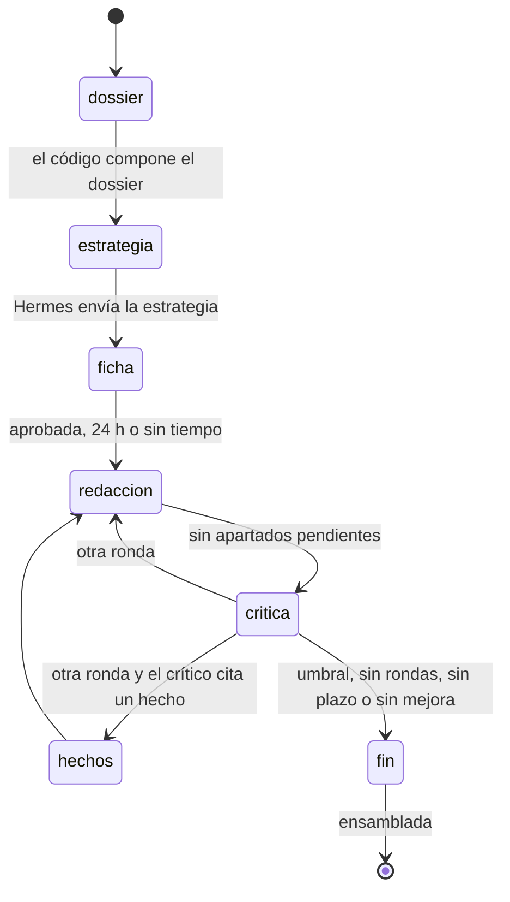

# Memoria técnica

Cómo redacta la plataforma la memoria técnica de una oferta: el diseño, el porqué de cada pieza,
cómo se configura y cómo se mide. Código: `apps/server/src/dominios/licitaciones/oferta/`.
Instrucciones de Hermes: skill `licitaciones`, `infra/hermes-init/skills/licitaciones/references/memoria.md`.
Los comentarios del código remiten a este documento por su número de paso.

## El problema

La memoria técnica es lo que la mesa puntúa con juicio de valor. Redactarla con un run de IA
independiente por apartado tiene tres defectos, y por eso la plataforma no lo hace así:

- **Sale genérica.** Cada run ve solo los pasajes de su apartado: no hay plan común ni temas que
  crucen la memoria, y cada apartado decide su estructura.
- **Se contradice.** Nadie fija los datos que se repiten. Ejemplo inventado: el apartado 2 dice
  «atención de 8:00 a 15:00» y el 4, «de 8 a 14 h».
- **Se puntúa mal.** El modelo que redacta, al evaluar su propia memoria, infla la nota (un 9 sobre
  10 a una memoria que un juez ciego deja en un 6, por ejemplo). Esa nota no distingue una memoria
  buena de una mediocre.

La plataforma hace lo que una persona experta: reúne todo el material en un solo contexto, planifica con
una hoja de hechos única, escribe la memoria entera de un tirón y la somete a un crítico
independiente que no conoce el plan. Si no llega a la nota, reescribe solo lo flojo con lo que
señala el crítico. Un banco de pruebas mide si el resultado se acerca a una memoria de referencia.

## Principios

- **Toda la IA corre en Hermes.** El monitor no tiene claves de LLM: encola trabajos y Hermes
  responde por tools MCP. El código compone el dossier, valida con zod, comprueba la coherencia,
  decide las rondas y monta el Word.
- **Un solo método, por fases.** Toda memoria nueva nace en `dossier` y recorre las fases hasta
  `fin`. Tienen `fase` nula las que no pasaron por ellas: una versión subida a mano (`subida` no
  nula), una restaurada de otra sin fase y las montadas por el método anterior. Solo la subida a
  mano no sirve de base para una versión nueva; las otras sí, entrando por el dossier y la
  estrategia que les faltan. Ensamblado, Salidas, fugas, subida a mano, lecciones
  y «Dar por buena» valen para todas.
- **Máquina de estados pura.** `siguientePaso(estado)` decide; la aplican la vuelta de la oferta y
  la llegada de cada resultado. Si se pierde un evento, nada se queda parado.
- **Rechazos con la frase exacta.** Un problema **duro** se rechaza siempre. Uno **blando** se
  rechaza dos veces (en 40 min) y al tercer envío entra con aviso: el agente no bloquea la memoria.
- **Los datos del CV solo van al perfil de oferta.** Ni a Salidas, ni al crítico, ni al juez.
- **El redactor nunca ve la nota del crítico,** solo sus motivos: escribe para lo que se señala,
  no para agradar al crítico.

## Flujo



| Paso | Fase (`memorias.fase`) | Quién | Trabajo y perfil | Tools MCP |
|---|---|---|---|---|
| 1 | `dossier` | código | — | (lo sirve `licitaciones_dossier`) |
| 2 | `estrategia` | Hermes | `licitaciones.memoria_estrategia`, oferta | `licitaciones_dossier`, `licitaciones_memoria_estrategia` |
| 2 | `ficha` | persona | — (web) | — |
| 3 | `redaccion` | Hermes | `licitaciones.memoria_redaccion`, oferta | `licitaciones_dossier`, `licitaciones_memoria_apartado` |
| 4 | al recibir y al cerrar | código | — | — |
| 5 | `critica` | Hermes | `licitaciones.memoria_critica`, crítico | `licitaciones_memoria_critica_paquete`, `licitaciones_memoria_critica`, `licitaciones_memoria_critica_pares` |
| 6 | `hechos` | Hermes | `licitaciones.memoria_hechos`, oferta | `licitaciones_memoria_hechos` |
| 6 y 9 | `fin` | código | ensamblado | — |
| 8 | — | Hermes | `licitaciones.eval_juicio`, crítico | `licitaciones_eval_paquete`, `licitaciones_eval_juicio` |

Perfiles de Hermes: `oferta-licitaciones` redacta (sin él, el de licitaciones);
`critico-licitaciones` critica y juzga (sin él, el de oferta, y la crítica queda marcada).

## Paso 0. Base: convivencia, fases y tiempos

- `POST /licitaciones/:id/oferta/memoria` acepta `{ ensayo?, lote? }`. La memoria nace en
  `dossier`, con apartados pendientes y sin trabajos. `recibirApartado` solo acepta un apartado
  `pendiente` de una memoria en `redaccion` y nunca ensambla: el documento se monta al cerrar las
  fases, después de la crítica.
- `vueltaMemorias` corre en la vuelta de la oferta y `avanzarMemoria` encadena pasos hasta el
  primero que espera.
- Cada fase con IA tiene un trabajo con clave `memoria-<licitación>-v<N>-…` (la «v<N>» es la
  versión de la memoria). Si falla, se
  reintenta 30 min después (`-r1`, `-r2`): tres intentos. Solo el primero salta el freno diario
  de runs por oferta, porque lo pidió una persona. Sin Salidas configurado, los trabajos esperan.

| Trabajo | Duración máxima | Sin llamar a ninguna tool |
|---|---|---|
| Estrategia | 60 min | 30 min (lee mucho y envía un JSON grande) |
| Redacción | 90 min | 15 min (cada apartado enviado es un latido) |
| Crítica | 45 min | 30 min |
| Corrección de hechos | 30 min | 30 min |
| Juicio del banco de pruebas | 45 min | 10 min |

- **Guardia de plazo.** Comprueba si da tiempo antes del plazo, dejando el margen de
  `LICITACIONES_MARGEN_FIRMA_HORAS`: 180 min para la memoria entera, 60 para una ronda y hasta 90
  para una nueva versión (menos si rehace pocos apartados). Si al pedirla no cabe, hay que
  confirmarla. Después, sin tiempo para reintentar una fase u otra ronda, la fase se salta con
  aviso. Una memoria de ensayo no tiene guardia.
- **Si un trabajo agota sus intentos:** la estrategia hace fallar la memoria (sin tiempo, se redacta
  sin ella, con la rúbrica); la redacción sigue con lo que llegó (sin nada, falla); la crítica se
  salta y se ensambla con aviso; la corrección de hechos se salta. Una fallida se reintenta desde
  la web.

## Paso 1. Dossier

`dossier.ts`, por código y sin IA: todo lo necesario para escribir la memoria en un solo sitio.
Cada sección tiene un tope; lo recortado lo dice y explica cómo seguir leyendo («[recortado: sigue
en biblioteca_leer …]»). Nada se pierde en silencio.

| Sección | Contenido | Tope | Al crítico |
|---|---|---|---|
| `identificacion` | Licitación, órgano, lotes, plazo, inicio previsto, duración y festivos | 5k | sí |
| `pliego_tecnico` | El pliego técnico entero si cabe; si no, las páginas de cada criterio con `[PPT p. N]` | 60k | sí |
| `aclaraciones` | Aclaraciones y respuestas a dudas de la carpeta de la licitación | 40k | sí |
| `cuadro_resumen` | Cuadro resumen del pliego administrativo | 12k | sí |
| `criterios` | Por apartado: título literal, puntos, «se valorará», escala, advertencias y páginas | 25k | sí |
| `formato` | Límite de páginas, fuente, cuerpo, interlineado y cierre | 5k | sí |
| `normativa_cliente` | Normas internas del cliente y contrato | 15k | no |
| `frontera` | Lo que la memoria no puede decir | 8k | no |
| `empresa` | Perfil de la empresa para agentes, sin contacto | 6k | no |
| `equipo` | Rol, dedicación, titulación y experiencia de cada persona | 10k | no |
| `herramientas` | Herramientas, medios y enfoque decididos | 4k | no |
| `lecciones` | Lecciones aceptadas de actas y de ediciones a mano | 6k | no |
| `parecidas` | Hasta 3 propuestas parecidas (ganadas primero) y la memoria de la mejor | 20k | no |

**La frontera** recoge las prohibiciones de cada archivo de la oferta, los criterios automáticos
que se acreditan en otro archivo (la memoria no puede adelantarlos) y que no hay importes. Añade
dos reglas. **Equipo por roles, sin nombres**, si el pliego pide CV anonimizados o puntúa la
experiencia del equipo en otro archivo: un nombre puede excluir la oferta. **No desmentir los
anexos**: un criterio automático al que nos acogemos y que se acredita en la propia memoria se
declara en ella, con su valor y sin importes.

Se guarda en `memoria_dossiers` y en Salidas (`memoria-vN-dossier.md`) **sin la sección `equipo`**.
`licitaciones_dossier` da el índice y las secciones por trozos; `equipo`, solo a agentes con
permiso sobre colaboradores.

## Paso 2. Estrategia

Trabajo `licitaciones.memoria_estrategia`, perfil de oferta. Hermes lee el dossier entero y envía
el plan con `licitaciones_memoria_estrategia`. No redacta: la estrategia es el contrato de la
redacción.

| Campo | Qué es |
|---|---|
| `temas` | De 3 a 6 temas ganadores: mensaje, por qué puntúa, la prueba y en qué apartados va |
| `audiencia` | Quién lee, con qué nivel, ejemplos de su día a día y qué evitar |
| `estructura` | Un elemento por apartado: título literal, extensión objetivo y secciones (tabla, figura, lista, cronograma, riesgos) |
| `mapa` | Cada «se valorará» → la sección que lo trata → la evidencia, en una frase legible |
| `hechos` | Hasta 80 (horario, plazo, rol, indicador, cifra, herramienta, calendario…): valor exacto, 1-5 palabras ancla, sigla del rol y apartados donde salen |
| `frontera`, `reglas` | Lo que no se dice y por qué; hasta 15 reglas de oro |
| `solucion` | Los parámetros de diseño decididos: calendario con fechas, arquitectura, modelos, umbrales, banco de pruebas, riesgos, dedicaciones, pendientes legítimos, catálogo normativo y compromisos |

**Revisión por código** (`problemasDeEstrategia`, pura). Blandos: títulos no literales, un «se
valorará» sin mapear, extensiones fuera de cuota, aplazamientos sin valor («a acordar», «T0»),
calendario sin fechas, menos de 2 cifras en un apartado que puntúa, rol largo sin sigla y modelos
anticuados. Duros: una fuga a otro archivo en un hecho o en la solución (se copiaría en todos los
apartados) y un nombre cuando el equipo va por roles. Con límite de páginas, cada apartado tiene
una cuota y la suma tiene que caber; sin límite, el techo es de 3.300 caracteres por «se valorará».
Se guarda en `memoria_estrategias` y en Salidas (`memoria-vN-estrategia.md`).

### Lo decidido se escribe como hecho

La mesa puntúa bajo las «carencias de detalle que requerirán concreción posterior». La estrategia
fija un valor para cada parámetro que el pliego deja al licitador, y la memoria lo afirma («El
servicio se presta de 9:00 a 18:00 h»). «Se ratifica en…» solo vale para lo que el pliego reserva
al órgano: como mucho 5 `pendientes_legitimos`, cada uno con su cita comprobada en el dossier.
Repetida, la fórmula se lee como aplazamiento; `aplazamientos.ts` la cuenta.

### Concreción verificable: versiones, normativa y medición

- **Versiones vigentes.** Un modelo o servicio con versión fechada más de 12 meses antes del inicio
  previsto parece anticuado, salvo que lo cite el pliego; si no consta una vigente, se nombra la
  familia y el criterio de sustitución (`vigenciaModelos.ts`, que no confunde la fecha de una API o
  de una norma con una versión).
- **Catálogo normativo del cliente.** Si `normativa_cliente` trae pasajes de normas, una fila por
  regla: id, regla, norma con su apartado, cita literal (comprobada contra el dossier) y dónde se
  aplica. Va como tabla en el diseño funcional: conocer al cliente separa un Excelente de un Bueno.
- **Medición coherente con el calendario.** Cada umbral dice en qué entorno y con qué datos se mide;
  nada se mide con datos reales antes de que el calendario lo permita. El crítico lo cuenta (paso 5).

### Compromisos con coste

Lo escrito en la memoria obliga al ejecutar el contrato: prometer lo que el pliego no exige ni
puntúa es coste sin puntos. `solucion.compromisos` lista lo que la memoria promete y cuesta:
`exigido` (con la cita del pliego, comprobada) o `anadido` (con el criterio que lo puntúa y por qué
compensa). El coste va en horas o en nivel (bajo, medio, alto), **nunca en euros**: la memoria va en
un sobre sin precios y ningún agente debe acercarle un importe. Por encima de 40 h es alto y avisa.
La instrucción pide la formulación más barata que puntúe (a petición, mensual, digital).

### Ficha de solución: revisión humana antes de redactar

`fichaSolucion.ts`, fase `ficha`, sin IA. Hermes propone parámetros, pero no sabe cuáles puede
cumplir la empresa. La ficha enseña a una persona lo que la memoria va a comprometer: hasta 20
parámetros, cada tramo del calendario, cada riesgo y cada compromiso añadido (mantener, suavizar o
quitar; alerta «Coste alto»). Se lee y aprueba con `GET/PUT …/oferta/memoria/:version/ficha`; lo
editado pasa a la solución y a los hechos atados a cada campo. La redacción espera hasta 24 h. Si
vence o no da tiempo, sigue con lo propuesto y avisa «FICHA DE SOLUCIÓN SIN REVISAR». De ensayo, no
hay ficha. La espera vive en la base: un reinicio del monitor no la pierde.

## Paso 3. Redacción entera

`redaccion.ts`. Un solo trabajo, `licitaciones.memoria_redaccion` (perfil de oferta), redacta todos
los apartados pendientes. Un único autor que escribe seguido mantiene voz, términos y datos.

- **Contexto:** la estrategia entera en línea, la ficha (manda sobre la estrategia), los hechos
  corregidos en la ronda y el índice del dossier, con la orden de leer antes `pliego_tecnico`,
  `criterios`, `frontera`, `equipo`, `aclaraciones` y `cuadro_resumen`. Por apartado, su rúbrica y
  su cuota (en rondas, lo del paso 6). Y las reglas de la casa (`memoriaInstrucciones.ts`): voz
  afirmativa, audiencia, figuras SVG y compromisos.
- **Latido:** cada apartado se envía con `licitaciones_memoria_apartado` al terminarlo. Cada envío
  queda en la auditoría de tools, que es lo que mira el control de inactividad; si el run se corta,
  lo enviado se queda.
- **Reanudación:** las instrucciones se calculan en cada intento. Un reintento pide solo lo
  pendiente y lleva un extracto de lo recibido para no contradecirlo.
- **Recepción:** `revisarApartado` (cuota, «cubre», figuras, fugas) más la coherencia del paso
  4. Pasar más de un 30 % de la cuota es duro. Se compromete solo lo listado: una frase que promete
  frecuencias, horas, guardias o material fuera de la lista es blanda. Los rechazos se cuentan por
  ronda.
- **Cierre:** sin pendientes, el código pasa la coherencia al documento entero y entra en `critica`.

### Prosa legible, no telegráfica

Para caber en la cuota, el modelo tiende a quitar artículos, verbos y conectores, y los jueces leen
un texto difícil. La regla pide párrafos completos y, si no cabe, quitar lo secundario.
`telegrafia.ts` mide la proporción de palabras gramaticales (umbral del 35 % con 150 palabras o más,
sin nombres ni siglas) y las palabras pegadas a barras o cifras: problema blando PROSA TELEGRÁFICA.
Más de una fórmula de ratificación por apartado también es blando.

## Paso 4. Hoja de hechos y coherencia

`hechos.ts` (puro) y `coherenciaMemoria.ts`. En las frases que llevan una palabra ancla de un
hecho se extraen valores normalizados según la categoría (horarios a minutos, `9:00-17:00` = «de 9
a 17 h»; plazos como «en 4 horas hábiles» o «24/7»; cifras con su unidad) y se comparan con la hoja.

| Hallazgo | Gravedad | Por qué |
|---|---|---|
| `contradiccion` con la hoja | blando al recibir; obliga a rehacer | la hoja es el contrato |
| `nombre` del equipo cuando va por roles | duro | arriesga la exclusión |
| `compromiso`: criterio acreditado en esta memoria sin su valor (documento) | obliga a rehacer | lo declarado en el anexo tiene que estar |
| `entre_apartados`: el mismo ancla con valores distintos (documento) | aviso | sin hecho que lo cubra |
| `repeticion`: la misma frase en varios apartados (documento) | aviso | se lee como relleno |
| `herramienta` fuera de las decisiones y la hoja | aviso | puede ser legítima |

Los hallazgos del documento entero se guardan en `memorias.coherencia` y salen en la web. Los que
obligan a rehacer entran como motivos en la ronda siguiente; los demás quedan para la persona.

## Paso 5. Crítico ciego

`critica.ts`. Trabajo `licitaciones.memoria_critica`, al perfil `critico-licitaciones` si están
`HERMES_OFERTA_CRITICO_URL` y `_KEY`; si no, al de oferta con `independiente = 0`, y la web avisa de
que esa nota tiende a sobrevalorar.

- **Paquete ciego** (`licitaciones_memoria_critica_paquete`, por partes y trozos): `rubrica`,
  `pliego` (solo las secciones «al crítico» del dossier) y `documento`, la memoria montada como la
  verá la mesa, con comprobaciones deterministas delante (numeración duplicada, frases repetidas,
  el mismo caso en varios apartados y, con un proveedor de costes, los compromisos caros). Nunca
  decisiones, estrategia, equipo ni evaluaciones anteriores.
- **Auditoría** (`TOOLS_PROHIBIDAS`): si el run tocó la oferta, el dossier, el detalle de la
  licitación, las propuestas, el equipo, los colaboradores o las evaluaciones, `ciega = 0`.
- **Por apartado:** `tramo` (de la escala del pliego), `puntos`, `cita` literal que lo justifica,
  `motivos_para_bajar` (cita, motivo y arreglo) y `falta` (cada «se valorará» sin tratar).
- **Anti-inflado por código:** tramo fuera de la escala, rechazado. Toda cita tiene que estar
  literal en el texto; sin ella, al tercer envío se guarda un tramo por debajo (sin evidencia, la
  nota no sube). Un tramo máximo no admite motivos ni faltas; uno inferior exige al menos un motivo.
- **Instrucciones:** «vocal técnico de la mesa, severo»; cada apartado empieza en el tramo más bajo
  y sube solo con una cita, comparado con el mejor competidor posible. `DEFECTOS_QUE_BAJAN` impiden
  el Excelente: aplazar valores, calendario sin fechas, ejemplos repetidos, figuras vacías,
  incoherencias entre calendario, entornos y medición, y comprometer lo caro que el pliego no pide.
- **Lecciones del equipo:** si la redacción las recibió, el crítico dice si se cumplen después de
  puntuar y sin tocar ningún tramo, para que la nota no se mueva hacia lo que el equipo quiere ver.
- **Nota con margen** (`tribunal.ts`): lo que perdería la memoria si la mesa pusiera cada apartado
  un tramo más abajo. Por debajo del 70 % de los puntos de juicio de valor es un riesgo.

Se guarda en `memoria_criticas` (`total`, `maximo`, `independiente`, `ciega`, `avisos`) y, por
apartado, en `memoria_apartado_rondas`.

### Calibración de tramos

Sin una vara, el crítico daba los mismos tramos a versiones muy distintas. La ronda 0 es absoluta,
pero las instrucciones explican qué separa los dos tramos más altos con la escala del propio
pliego. Nunca con una memoria de referencia, que sesgaría hacia su estilo.

### Crítica por pares en las rondas

Con una nota absoluta por ronda, el ruido del crítico tapa la mejora. Desde la ronda 1 se compara
(`criticaPares.ts`). El paquete añade `documento_1` y `documento_2`: la versión conservada y la
nueva, montadas igual, en un orden que alterna con la ronda (contra el sesgo de posición) y sin
decir cuál es cuál. `licitaciones_memoria_critica_pares` recibe, por apartado, el preferido («1»,
«2» o «empate»), la evaluación de cada documento y, sin empate, la diferencia. Un apartado idéntico
es empate con el mismo tramo, y el preferido no puede tener menos tramo que el otro. Se conserva la
preferida; con empate, la nueva; a igual valor, la que compromete menos coste.

## Paso 6. Rondas de reescritura

`rondasMemoria.ts`. Con la crítica de la ronda, `decidirRonda` (pura) decide en este orden:

1. **Llega al umbral** (total ≥ `LICITACIONES_MEMORIA_UMBRAL` × máximo, ningún apartado a más de un
   tramo del máximo, ningún hallazgo que obligue a rehacer): se ensambla, salvo que se pase de páginas.
2. Agotadas las rondas (`LICITACIONES_MEMORIA_RONDAS`) o sin tiempo: se ensambla con aviso.
3. **La versión nueva no gana:** por pares, sin preferirla en ningún apartado y sin bajar los
   bloqueantes, se ensambla con lo mejor de cada apartado.
4. **Dos rondas seguidas sin progreso** se ensamblan. Progreso es que bajen los bloqueantes si los
   hay; si no, por pares, ganar algún apartado; si no, subir el mejor total.
5. Si no, se rehacen los apartados con tramo bajo y motivos, con faltas, con hallazgos que obligan
   a rehacer o que se pasan de cuota. Si la nota llega pero la memoria se pasa del límite de
   páginas, la ronda solo recorta los que más se pasan.

**Guarda de regresiones.** Un apartado reescrito que baja un tramo o más frente a su mejor versión
vuelve a ella y queda bloqueado; por pares, bajar es que se prefiera la anterior. El mismo texto con
otra nota es ruido y no cuenta. Uno de pantallas tiene un reintento más, con orden de conservar sus
figuras. Un bloqueante idéntico en dos rondas deja el apartado a una persona, con aviso.

**Qué recibe el redactor** (`aplicarRonda` deja pendientes los elegidos en una transacción): el
texto actual (el restaurado, si la ronda lo empeoró), los motivos y faltas del crítico (los que se
repiten sobre un texto ya reescrito, marcados «NO RESUELTO» para que cambie el enfoque), los
hallazgos y la extensión: no crecer más de un 10 %, cada añadido sustituye texto. **Nunca la nota.**
Lo que pide el crítico no se vuelve compromiso fijo salvo que el criterio lo valore expresamente.

### Corrección de los hechos que cita el crítico

Si el crítico señala justo un valor de la hoja, reescribir no lo arregla: la coherencia rechaza lo
que la contradice. Si un motivo cita literalmente el valor de un hecho (no de rol, de 5 caracteres
o más; hasta 5 hechos), la ronda pasa antes por la fase `hechos` (`parcheHechos.ts`). El trabajo
`licitaciones.memoria_hechos` va al perfil de oferta, nunca al del crítico, porque lee la
estrategia; Hermes envía con `licitaciones_memoria_hechos` el valor nuevo o mantiene el anterior
diciendo por qué. Se respeta la ficha aprobada salvo que el motivo la contradiga. Cada cambio pasa
a la solución y a la ficha, queda como aviso «HECHO CAMBIADO» y rehace los apartados que usan el
hecho. Una versión con el valor viejo ya no se restaura por regresión.

### Fin

Se recuperan los apartados que una ronda no devolvió, se pasa la coherencia del documento, se
anotan los avisos (incluidas las acreditaciones que alguien debe poder probar) y se ensambla con
`ensamblarMemoria`. La última crítica se guarda como evaluación: la memoria no se autoevalúa y la
web, «Mejorar» y «Nueva versión» parten de ella. Una persona puede ensamblar ya una memoria que
espera a la crítica (`POST …/memoria/:version/ensamblar`).

## Paso 7. Seguimiento en la web

La web muestra las fases de la memoria con su trabajo en curso,
el dossier y la estrategia en Salidas, la ficha, una tabla ronda × apartado con el tramo y las
restauraciones, la hoja de hechos, los hallazgos, las correcciones de hechos y las marcas «crítico
independiente» y «ciego». A agentes sin permiso sobre colaboradores, el estado de la memoria (`progreso` en
`licitaciones_oferta`) les llega sin hoja de hechos, citas ni motivos. **Estado** dice de qué perfil sale la crítica.

## Paso 8. Banco de pruebas de memorias

`evalMemorias.ts` y `apps/server/scripts/evalMemorias.ts`. Mide si el juez distingue una memoria
buena de una mediocre y cuánto se acerca una memoria de la plataforma a una de referencia. El juez
compara a ciegas y por pares, en el perfil del crítico.

**Un caso** es una carpeta `apps/server/tests/licitaciones/fixtures/eval/<caso>/`:

- `rubrica.json`: criterios con sus puntos y su escala, y advertencias. Ejemplo inventado:
  `{ "titulo": "Servicio de ejemplo", "criterios": [{ "titulo": "Metodología", "puntos": 10,
  "escala": [{ "puntos": 10, "descripcion": "Excelente…" }, { "puntos": 5, "descripcion":
  "Aceptable…" }] }], "advertencias": [] }`.
- `pliego.md`: lo que el juez necesita del pliego (objeto, cómo se valora, criterios y escala).
- Un `.md` por memoria; la etiqueta es el nombre del archivo (`referencia.md`, `plataforma.md`).
  Con el `.json` del ensamblado al lado, el texto se rehace desde él con el contenido de las figuras.
- `esperado.json`: `{ "preferido": "<etiqueta>" }`, el resultado que tiene que dar el juez.
- `nombres.json` (opcional, **nunca en el repo**; con `--dir` a una carpeta fuera de él): las
  personas que hay que anonimizar.

Todas las memorias se normalizan igual: sin la línea de la licitadora, personas → «Persona A/B…» y
NIF → `[NIF]`. Si una trae figuras y otra no, el script avisa. No subas datos de un cliente sin
anonimizar.

```bash
cd apps/server   # con el monitor en marcha sobre la misma base: él lanza los juicios
PLATAFORMA_DATA_DIR=<datos del monitor> npx tsx scripts/evalMemorias.ts \
  --caso <caso> --docs referencia,plataforma --esperar [--dir <carpeta del caso>]
```

El script carga el caso en `eval_casos` y `eval_documentos` (idempotente por clave y sha256) y
encola dos **juicios**, uno por orden, con el mismo lote; no llama a Hermes. Con `--esperar`
consulta cada 30 s (hasta 3 h) e imprime la tabla criterio × orden con el veredicto. Sale con 0 si
coincide con el esperado, 1 si lo contradice (también con empate) y 2 si hay un error.

**El juicio** (`licitaciones_eval_paquete` para leer, `licitaciones_eval_juicio` para enviar) trae
por criterio: preferido, margen (0-3), puntos de cada documento, razón y cita literal del
preferido. El código exige un juicio por criterio, puntos dentro del peso, totales que sumen y
citas que estén en el documento. **El veredicto** es la media de los dos órdenes. Si cada orden
prefiere el documento que va primero hay **sesgo de posición**: empate con alerta, el juicio no
vale y se repite o se cambia el modelo del crítico.

## Paso 9. Word

El ensamblado acepta `**negrita**` y `*cursiva*` (sin contar las marcas como caracteres), listas
numeradas y tablas apaisadas (automáticas desde 6 columnas). Tras el índice va la **tabla
guía** «Cómo se responde a cada criterio», generada desde `estrategia.mapa`: una fila por criterio,
con el número real de la sección que lo trata y la evidencia.

### Tabla guía legible

La evidencia sale tal cual, así que la estrategia pide una frase legible; una apelmazada (palabras
o cifras pegadas) es blanda. Al ensamblar, `legible` separa solo lo que no deja duda («24h» o «1,5»
quedan igual) y `filasDeGuia` agrupa los trozos sueltos del «se valorará» bajo su criterio. Lo que
sigue ilegible se sustituye por una remisión a la sección.

## Paso 10. Configuración y puesta en marcha

| Variable | Por defecto | Efecto |
|---|---|---|
| `LICITACIONES_MEMORIA_UMBRAL` | `0.9` | Parte de los puntos (0,5-1) con que la crítica da la memoria por buena |
| `LICITACIONES_MEMORIA_RONDAS` | `3` | Rondas de reescritura como mucho (0-3; con 0, una crítica y se ensambla) |
| `HERMES_OFERTA_CRITICO_URL` / `_KEY` | — | Perfil del crítico. Sin los dos, critica el de oferta; con uno solo, Estado avisa |
| `HERMES_OFERTA_LICITACIONES_URL` / `_KEY` | — | Perfil de oferta; sin él, el de licitaciones |
| `LICITACIONES_PRECIO_HORA` | — | La ficha enseña a la persona los euros de cada compromiso (horas × precio); no se guarda ni llega a ningún agente |
| `LICITACIONES_MARGEN_FIRMA_HORAS` | `2` | Horas antes del plazo que la guardia reserva para firmar y subir |
| `LICITACIONES_RUNS_OFERTA_DIA` | `40` | Freno de runs por oferta en 24 h (los reintentos cuentan) |

Para que la nota sea fiable:

1. Crea `critico-licitaciones` en Hermes **con otro modelo** que el de oferta y configura su URL y su
   clave ([Perfiles de Hermes](../operar/perfiles-de-hermes.md)).
2. Pasa el banco con un caso cuyo esperado sea la memoria de referencia: el juez debe preferirla.
3. Añade al caso una memoria de la plataforma. Orientación: en una rúbrica de 25 puntos, 21 o más de
   media y a 3 puntos o menos de la referencia.

Si cambia el esquema de una tool (por ejemplo, la de la estrategia), reinicia Hermes para que lo cargue.

## Variantes

- **Memoria por lote.** Si el pliego la pide, una memoria por lote decidido, con su dossier y solo las
  decisiones de su lote; se le prohíbe hablar de los otros.
- **Nueva versión y actualizar los apartados afectados.** Las dos acciones de la web y la fase
  `ronda_memoria` de `licitaciones_pedir` crean una memoria nueva con `actualizarMemoria`, sobre
  una base ensamblada que no se subió a mano (una subida, `memorias.subida` no nula, da
  `conflicto`: Hermes no rehace el documento de una persona). La versión siguiente copia palabra
  por palabra los apartados que no se rehacen (con sus ediciones a mano), conserva la estrategia
  de la base sin los hechos que el cambio dejó atrás y recompone el dossier por código. Solo se
  redactan y critican los apartados elegidos. Con una base con fases y del guion vigente nace
  directamente en `redaccion`; con una montada por el método anterior (sin estrategia) o de un
  guion anterior compatible nace en `dossier`, y la máquina de fases compone el dossier con el
  guion de la versión y pide la estrategia si falta.
  - **Dos clases** (`memorias.mejora`). `…/actualizar-afectados` es un **cambio tardío**: cada
    apartado conserva su texto y cambia solo lo que depende del cambio. `…/mejorar` y
    `ronda_memoria` son una **mejora**: cada apartado se reescribe para su tramo máximo con la
    evaluación de la base (justificación, tramo, sugerencias y párrafos genéricos,
    `mejoraMemoria.ts`); hace falta esa evaluación salvo que la persona dé indicaciones.
  - **Qué apartados.** El cuerpo común es `{ cambio?, cambios?[≤5], apartados?[], indicaciones?(≥10
    caracteres) }`. Sin `apartados`, en un cambio tardío, los que nombran el cambio (los mismos que
    cobra «Qué cambia», `apartadosAfectados.ts`) o, sin cambio, los que dicen las huellas del
    dossier (equipo, herramientas, empresa, lotes, plazo; `desfaseMemoria`); en una mejora, los
    que la evaluación deja por debajo de su tramo máximo. Se rehacen siempre un apartado que no
    llegó a redactarse y, con una base de un guion anterior compatible (mismos apartados, orden,
    límite y formato), los que cambiaron de puntos, contenido o escala. Devuelve
    `{ memoria, version, apartados }`.
  - **Quién manda.** Las `indicaciones` de la persona mandan; el `motivo` que envía Hermes en
    `licitaciones_pedir` va aparte (`memorias.motivo_agente`) como contexto, y un agente no puede
    mandar indicaciones. Ninguna fase de una versión pedida por un agente, ni de una memoria que
    pide la cadena sola, levanta el freno de su tipo (`memorias.por_agente`).
  - **Vista previa y diff.** `GET …/memoria/:version/afectados` dice a qué apartados afecta lo
    cambiado sin escribir nada. En la versión nueva, cada apartado rehecho se lee como diff y
    **Mantener el anterior** devuelve el de la base y monta la versión sin IA.
  - **`ronda_memoria`.** Es asíncrona: el id de trabajo devuelto es el de la redacción de la fase,
    o 0 si aún no se encoló.
  - **Frenos.** No se actualiza una memoria de ensayo, la presentada, una subida a mano, una de un
    guion con otros apartados ni mientras otra versión del mismo lote se redacta o se ensambla.
- **Memoria de ensayo.** Para medir con una licitación ya vencida: sin guardia de plazo ni ficha,
  con sufijo `-ensayo` en Salidas y sin pisar la memoria dada por buena.

## Límites conocidos y por qué existen los frenos

- **Coste.** Una memoria con tres rondas son unos 6-8 runs largos. Por eso el
  tope de 3 rondas, la parada tras dos sin progreso o si la nueva no gana, y reescribir solo lo flojo.
- **Ruido del crítico.** Dos críticas del mismo texto varían hasta medio tramo: restaurar exige
  bajar un tramo entero, el mismo texto con otra nota no cuenta y las rondas se juzgan por pares.
- **Umbral alto (0,9) y nadie a más de un tramo del máximo**, para que un buen total no esconda un
  apartado flojo. Bajarlo ensambla antes memorias más flojas.
- **Mismo modelo, nota inflada.** Sin perfil de crítico propio la nota vale poco; la web lo marca,
  pero no lo impide.
- **Contexto largo.** Dossier, estrategia y salida rozan el límite de un run; por eso el dossier se
  lee por secciones. Si el modelo pierde el hilo, la alternativa es partir la redacción en bloques
  con la misma estrategia y la misma hoja de hechos.
- **La coherencia es por reglas:** detecta horarios, plazos y cifras junto a sus anclas; una
  paráfrasis sin ancla se le escapa y las herramientas desconocidas solo avisan.
- **Las páginas se estiman** a partir de caracteres; el Word final puede variar algo.
- **El plazo manda sobre la calidad:** sin tiempo se saltan estrategia, crítica o corrección de
  hechos, siempre con aviso. Mejor una memoria marcada que ninguna.
- **El banco de pruebas no va en la imagen de producción** (sin `tsx` ni casos): se lanza desde el
  repo contra la base del monitor. Tampoco calibra aún al crítico del paso 5 con los casos: el juez
  usa su mismo perfil, pero otro paquete.
